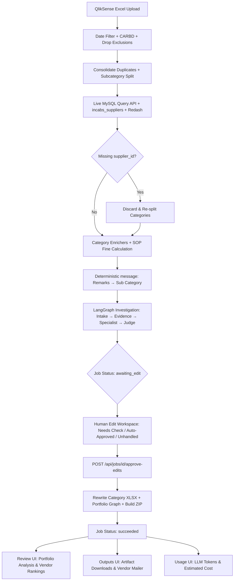

# Agentic Loss Recovery Copilot

React 18 + FastAPI platform that automates the transformation of QlikSense loss-recovery workbooks into verified Cab Ops recovery packages, featuring live MySQL/Redash data integration, a **LangGraph** multi-agent investigation system, a human **Edit Workspace**, and a deterministic **Vendor Penalty Mailer**.

---

## 🚀 Key Subsystems & Workflow



1. **Ingestion & Filtering:** Ingests QlikSense Excel rows, filters by inclusive `Approval/Rejected DateTime` range (or skips with `process_all=true`), filters to `CARBD` with non-zero recoverable amounts, and drops non-actionable rows (`User cancellation`, `Customer Delight`, and paid-amount refunds).
2. **Duplicate Consolidation:** Merges multiple claims per `Booking ID`, aggregates loss and recoverable amounts, and merges remarks.
3. **Live Tracking & Supplier Join:** Queries live tracking records via internal MySQL HTTP API (`tracking_reports_raw`) and joins vendor display names via `incabs_suppliers`. Bookings lacking a valid `supplier_id` across all tracking rows are discarded upfront with explicit warnings.
4. **SOP Fine Calculation:** Computes deterministic fines for `Fulfillment Not Done / Vendor No Show` ($\min(0.50 \times \text{amount}, 500)$ for airport/local; $\min(0.25 \times \text{amount}, 2000)$ for others) using `Decimal ROUND_HALF_UP`.
5. **Deterministic Message Synthesis:** Normalizes complaint `message` from Remarks $\rightarrow$ Sub Category against 15 canonical allowed categories (`A + B`). Customer call comments are never used to rewrite the message.
6. **LangGraph Investigation:** Executes per-case agent graphs (`intake` $\rightarrow$ `evidence_agent` $\rightarrow$ `specialist` $\rightarrow$ `judge` $\rightarrow$ `finalize`) with `enable_hitl=False`.
7. **Human Edit Workspace:** Pauses at `awaiting_edit`. Operators review cases across 3 AI buckets (`needs_check`, `auto_approved`, `unhandled`), perform inline or bulk edits (`include`, `needs_ops`, `exclude`), and trigger final packaging.
8. **Packaging & Portfolio:** Rewrites processed category workbooks, excludes omitted bookings from `final_output.xlsx`, runs the portfolio analysis graph, and compiles `agentic_loss_recovery_package.zip`.
9. **Vendor Penalty Mailer:** Freezes one draft per recipient with a SHA-256 preview token and dispatches deterministic table-formatted emails via STARTTLS SMTP.
10. **LLM Token & Cost Accounting:** Tracks prompt, completion, and cached tokens by functional purpose, displaying real-time financial costs.

---

## 📖 Modular Documentation Suite

Detailed, code-verified documentation is available in the [`docs/`](docs/) directory:

- **[Master Documentation Hub](docs/README.md)** — Index of all documentation guides and workflows.
- **[System Architecture](docs/architecture.md)** — Architectural design, component topologies, and state machines.
- **[Data Pipeline & ETL Engine](docs/pipeline-and-etl.md)** — Workbook parsing, date filtering, drop rules, deduplication, and supplier validation.
- **[External Integrations](docs/integrations.md)** — MySQL Query API, direct MySQL fallback, Redash call comments, Azure OpenAI, and SMTP transport.
- **[Category Processors & SOP Fine Engine](docs/category-processors.md)** — Category registries, common tracking attributes, and the Vendor No Show SOP fine formula.
- **[Complaint Mapping & Message Synthesis](docs/complaint-classification.md)** — The 15 canonical categories, alias dictionary, regex extractors, and delay duration parsing.
- **[LangGraph Multi-Agent Investigation](docs/langgraph-investigation.md)** — Multi-agent state graph, evidence tools, specialist roles, and judge guardrails.
- **[Human Edit Workspace & Decision Stage](docs/edit-stage-and-human-in-the-loop.md)** — AI bucket routing, field permissions, bulk actions, and approval lifecycle.
- **[Packaging & Output Artifacts](docs/packaging-and-artifacts.md)** — Specifications for `final_output.xlsx`, `agent_audit.xlsx`, `manifest.json`, and ZIP bundles.
- **[Vendor Penalty Mailer](docs/vendor-mailer.md)** — Deterministic mailer graph, table templates, preview freeze token, and SMTP dispatch.
- **[LLM Token Usage & Cost Tracking](docs/llm-usage-and-cost.md)** — Token extraction, purpose tagging, pricing rates, and UI analytics.
- **[REST & SSE API Reference](docs/api-reference.md)** — Complete endpoint directory, request/response models, and SSE event streaming.
- **[Frontend Architecture & UX](docs/frontend-architecture.md)** — React 18, Vite, TypeScript, `JobProvider` session management, and UI component design.
- **[Deployment & Operational Runbook](docs/deployment-and-configuration.md)** — Environment variables, concurrency tuning, setup, testing, and troubleshooting.
- **[Agent Playbook & Change Recipes](docs/agent-playbook.md)** — Quick change recipes for software engineers and AI coding agents.

---

## 💻 Quickstart

### 1. Configure Environment
```bash
cp .env.example .env
# Edit .env with your credentials (see docs/deployment-and-configuration.md)
```

### 2. Install Dependencies
```bash
# Backend (Python 3.12+)
uv sync

# Frontend (Node.js 18+)
cd frontend && npm install && cd ..
```

### 3. Run Locally

**Backend API (Port 8000):**
```bash
uv run uvicorn backend.app.main:app --reload
```

**Frontend Dev Server (Port 5173):**
```bash
cd frontend && npm run dev
```

### 4. Run Test Suite
```bash
# Backend tests (153 tests)
uv run pytest

# Frontend production build
cd frontend && npm run build
```

---

## 📂 Deliverables & File Layout

When a job succeeds, the following artifacts are generated inside `backend/.runtime/{job_id}/`:

| Artifact | Format | Description |
| :--- | :---: | :--- |
| `final_output.xlsx` | Excel | 7-column sanitized Cab Ops recovery workbook (excluded rows omitted). |
| `agent_audit.xlsx` | Excel | 33-column immutable audit trail documenting all decisions, evidence, and edits. |
| `review_queue.xlsx` | Excel | Cases requiring ops follow-up (`needs_review`, `missing_evidence`, etc.). |
| `agent_summary.json` | JSON | Executive portfolio metrics, category statistics, and vendor penalty rankings. |
| `manifest.json` | JSON | Machine-readable manifest tracking row counts and relative file paths. |
| `mailer_dispatch.json` | JSON | Frozen vendor email drafts, preview token, and delivery timestamps. |
| `agentic_loss_recovery_package.zip` | ZIP | Complete archive containing all category files and output artifacts. |
