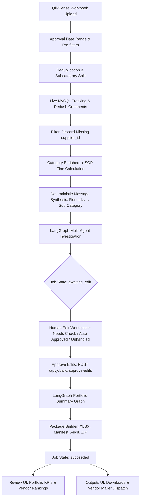

# Agentic Loss Recovery Copilot — Documentation Hub

Welcome to the comprehensive, modular technical documentation for the **Agentic Loss Recovery Copilot** project. This documentation suite is designed for human software engineers, operational managers, and autonomous AI agents. Every document is strictly grounded in the latest codebase.

---

## 📚 Documentation Map

The documentation is organized into modular guides. Each document covers a specific subsystem in complete depth:

| Document | Focus & Summary | Primary Audience |
| :--- | :--- | :--- |
| **[1. System Architecture](architecture.md)** | High-level system architecture, component interactions, job lifecycle state machine, and data flow from QlikSense Excel to Cab Ops ZIP. | Architects, Engineers, AI Agents |
| **[2. Data Pipeline & ETL Engine](pipeline-and-etl.md)** | Step-by-step ingestion lifecycle: date range filtering, CARBD filters, non-zero recoverable rules, drop filters (User cancellation, Customer Delight, paid-amount refund), deduplication, and supplier validation. | Backend Devs, Data Ops |
| **[3. External Integrations](integrations.md)** | Specifications for live MySQL HTTP Query API (`runQuery`), direct MySQL fallback, supplier joining (`incabs_suppliers`), Redash Call Comments (`MyDesk`), Azure OpenAI, and SMTP transport. | Systems Engineers, Integration Leads |
| **[4. Category Processors & SOP Fine Engine](category-processors.md)** | Category processor registry (`CATEGORY_ASYNC_ENRICHERS`), category enrichers (Cab Delay, Extra Money Taken, Lower Category Vehicle), and the Vendor No Show / SOP Fine formula (`ROUND_HALF_UP`). | Domain Devs, Cab Ops Leads |
| **[5. Complaint Mapping & Message Synthesis](complaint-classification.md)** | 15 allowed canonical complaint categories, normalization rules, Remarks-first priority, delay window duration extraction, and deterministic `message` synthesis (`A + B`). | Policy Leads, NLP/Prompt Engineers |
| **[6. LangGraph Multi-Agent Investigation](langgraph-investigation.md)** | The multi-agent investigation system: state schema, per-case graph (`intake` → `evidence` → `specialist` → `judge` → `finalize`), portfolio graph, evidence tools, source alignment, and guardrails. | AI/Agent Engineers, ML Ops |
| **[7. Human Edit Workspace & Decision Stage](edit-stage-and-human-in-the-loop.md)** | Production human-in-the-loop edit stage: `awaiting_edit` lifecycle, 3 AI buckets (`needs_check`, `auto_approved`, `unhandled`), edit outcomes (`include`, `needs_ops`, `exclude`), bulk patch actions, and field permissions. | Product Managers, Operations Teams |
| **[8. Packaging & Artifacts Specification](packaging-and-artifacts.md)** | Specifications for output files: `manifest.json`, `final_output.xlsx`, `agent_audit.xlsx`, `review_queue.xlsx`, `agent_summary.json`, category files, and the final ZIP archive. | Integration Partners, Data Engineers |
| **[9. Vendor Penalty Mailer](vendor-mailer.md)** | Deterministic mailer graph (`assign` → `compose` → `validate` → `send` → `finalize`), draft freezing via SHA-256 tokens, table-based HTML email templates, and SMTP dispatch idempotency. | Communication Ops, Backend Devs |
| **[10. LLM Token Usage & Cost Tracking](llm-usage-and-cost.md)** | Granular token accounting and cost estimation across agent purposes (`specialist`, `judge`, `source_alignment`, `lower_category_vehicle`, `portfolio`), rate configuration, and UI analytics. | Finance, Tech Leads, Ops |
| **[11. REST & SSE API Reference](api-reference.md)** | Complete HTTP API specification: endpoints, request/response models, pagination parameters, Server-Sent Events (SSE) protocol, and error contracts. | Frontend Devs, API Consumers |
| **[12. Frontend Architecture & UX](frontend-architecture.md)** | React 18, Vite, TypeScript architecture: `JobProvider` session management, multi-stage routing (`Progress` → `Edit` → `Review` → `Outputs` → `Usage`), and UI component design. | Frontend Engineers, UI/UX Designers |
| **[13. Deployment & Operational Runbook](deployment-and-configuration.md)** | Environment variable dictionary (`.env`), concurrency tuning, local development, verification commands, error codes, and troubleshooting. | DevOps, SREs, Maintainers |
| **[14. Agent Playbook & Change Recipes](agent-playbook.md)** | Quick-start modification recipes for software engineers and AI coding agents (adding categories, updating guardrails, extending schemas). | Coding Agents, Contributors |

---

## ⚡ High-Level System Workflow

---

## 🧭 Design Principles & Core Invariants

1. **Deterministic Business Core:**
   - Financial penalties, complaint category classification, and message strings are derived deterministically.
   - LLMs are never allowed to invent penalty amounts or fabricate message categories.
   - Call comments are strictly supporting evidence and display context; they **never** override Remarks or Sub Category when generating the penalty `message`.

2. **Non-Negotiable Edit Gate:**
   - Production pipeline runs with `enable_hitl=False` inside the graph and pauses at `awaiting_edit`.
   - Human operators review cases segregated into 3 explicit AI buckets:
     - `needs_check`: Cases requiring operational verification (e.g., missing SOP inputs, unaligned evidence).
     - `auto_approved`: Cases where evidence aligns cleanly with policy.
     - `unhandled`: Cases with blank or unmapped Sub Categories.
   - Edits update the underlying processed workbooks and propagate consistently into final artifacts.

3. **Zero Data Loss & Strict Filtering:**
   - Pre-filters eliminate non-actionable rows upfront: non-CARBD departments, zero recoverable amounts, `User cancellation`, `Customer Delight`, and paid-amount refunds.
   - Bookings lacking a valid `supplier_id` across all tracking rows are discarded before category processing with an explicit warning.

4. **Auditability & Traceability:**
   - Every case maintains an immutable audit trail (`agent_audit.xlsx`) documenting agent decisions, confidence scores, evidence IDs, and human edit modifications.
   - All token consumption and financial costs are recorded per purpose and visible in the user interface.

