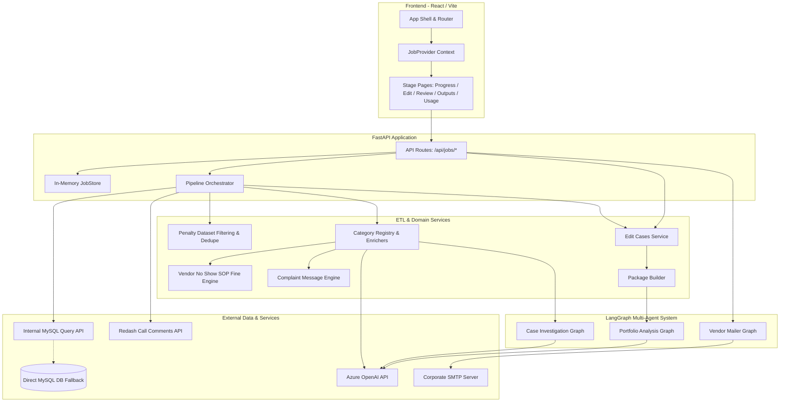
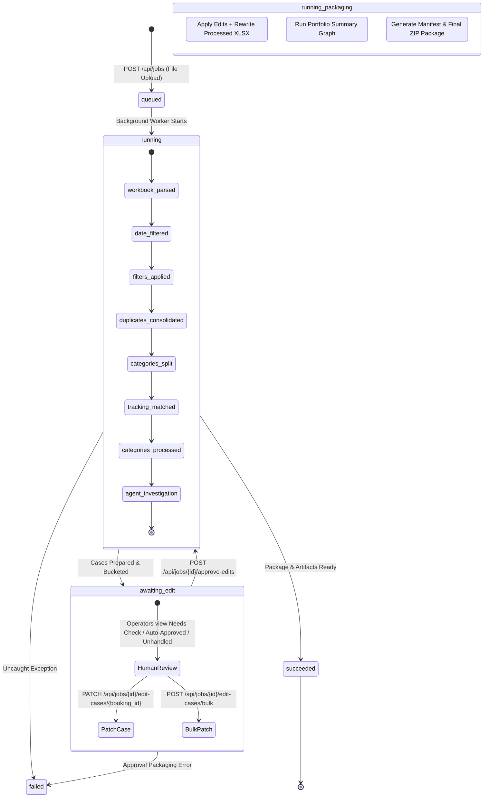

# System Architecture & Topologies

This document details the software architecture, runtime topology, execution state machines, and directory organization of the **Agentic Loss Recovery Copilot**.

---

## 1. High-Level Architectural Overview

The application is architected as a decoupled, multi-tier system:

1. **Presentation Layer (Frontend):**
   - Single-Page Application (SPA) built with **React 18**, **TypeScript**, and **Vite**.
   - State management via persistent React Context (`JobProvider`) and custom hooks (`useJobSession`).
   - Real-time updates delivered via **Server-Sent Events (SSE)** and smart polling fallback.
   - Interactive visualizations with **Mermaid.js** and **Lucide React** icon primitives.

2. **API & Orchestration Layer (Backend):**
   - Asynchronous RESTful service built with **FastAPI** running on **Uvicorn**.
   - Thread-safe, in-memory state store (`JobStore`) maintaining job lifecycles, execution step progress, and SSE event broadcast buffers.
   - Concurrency control via `asyncio.Semaphore` for category processing and LLM calls.

3. **Data Processing & Domain Layer:**
   - Vectorized data wrangling with **Pandas** and **OpenPyXL**.
   - Strict domain schemas enforcing financial precision (`Decimal` arithmetic with `ROUND_HALF_UP`).
   - Deterministic pattern-matching engines for complaint classification and message formatting.

4. **Agentic Layer (LangGraph):**
   - **Case Investigation Graph:** Multi-agent pipeline executing specialized verification per booking.
   - **Portfolio Analysis Graph:** Aggregate synthesis producing executive summaries and vendor performance metrics.
   - **Vendor Penalty Mailer Graph:** Deterministic orchestration graph managing recipient assignment, template rendering, validation, and SMTP dispatch.

5. **Integration & Infrastructure Layer:**
   - Internal HTTP MySQL Query Service (`cabs-incabs-ryde-reports.prd.mmt.internal`) with fallback to direct PyMySQL connections.
   - Redash HTTP API integration for customer call transcripts.
   - Azure OpenAI integration for structured analysis and extraction.
   - Enterprise SMTP transport with STARTTLS for vendor notifications.

---

## 2. System Component Topology



---

## 3. Job Lifecycle State Machine

A processing job moves through a sequence of formal lifecycle states represented by the `JobStatus` type:

```text
JobStatus = "queued" | "running" | "awaiting_edit" | "awaiting_review" | "succeeded" | "failed"
```

### Production Execution Lifecycle



### State Definitions & Trigger Contracts

1. **`queued`**:
   - The workbook has been uploaded to `backend/.runtime/{job_id}/input.xlsx`.
   - Initial metadata recorded in `JobStore`.
   - Asynchronous background task `run_processing_job` scheduled.

2. **`running` (Ingestion & Investigation Phase)**:
   - Synchronous ETL executes: date range filtering, CARBD filter, non-zero recoverable filter, exclusion filters (`User cancellation`, `Customer Delight`, paid-amount refunds), duplicate consolidation.
   - Subcategory batch files written to `category_files/prepared/{slug}.xlsx`.
   - Live tracking fetched via MySQL HTTP Query API and Redash.
   - Validation filter discards bookings missing `supplier_id` across all tracking rows.
   - Concurrent category enrichers execute (Cab Delay, Extra Money Taken, SOP fine calculation, Lower Category Vehicle).
   - Deterministic message column enriched.
   - LangGraph per-case investigation runs with `enable_hitl=False`.

3. **`awaiting_edit` (Human Gate Phase)**:
   - LangGraph investigation finishes for all cases.
   - Cases snapshot into 3 AI Buckets (`needs_check`, `auto_approved`, `unhandled`).
   - The job execution halts; no further background processing occurs until human operators take action.
   - Operators can modify editable fields (`recoverable_amount`, `message`, `remarks`, `sub_category`, `edit_outcome`) individually or in bulk.

4. **`running` (Packaging & Portfolio Phase)**:
   - Triggered by `POST /api/jobs/{job_id}/approve-edits`.
   - Human edit decisions (`include`, `needs_ops`, `exclude`) applied.
   - Category processed Excel workbooks rewritten with edited values.
   - Excluded cases filtered out from `final_output.xlsx` and zeroed out in portfolio totals.
   - LangGraph portfolio graph executed to produce executive summaries and vendor rankings.
   - `final_output.xlsx`, `agent_audit.xlsx`, `review_queue.xlsx`, `agent_summary.json`, and `manifest.json` generated.
   - Root ZIP archive compressed.

5. **`succeeded`**:
   - Packaging successfully finalized.
   - Artifacts unlocked for download via UI and REST endpoints.
   - Real-time token usage summary and estimated cost unlocked on `/jobs/{id}/usage`.
   - Vendor Penalty Mailer panel unlocked on `/jobs/{id}/outputs`.

6. **`awaiting_review` (Legacy / Test-Only)**:
   - Entered only when `enable_hitl=True` (used in unit tests to test LangGraph `interrupt()` primitives).
   - Resumed case-by-case via `POST /api/jobs/{job_id}/cases/{booking_id}/resume`.

7. **`failed`**:
   - Unhandled exception occurred during ingestion, database querying, or packaging.
   - Error reason recorded in `job.error` and displayed across UI surfaces.

---

## 4. Directory Structure & Codebase Map

```text
vendor_payout_and_penalty_automation-git/
├── backend/
│   ├── app/
│   │   ├── main.py                     # FastAPI routes, lifecycle lifespan, preview endpoints
│   │   ├── models.py                   # Pydantic v2 data models for API requests and responses
│   │   ├── core/
│   │   │   ├── env.py                  # Dotenv loading utilities
│   │   │   ├── paths.py                # Repository, runtime, and reference paths
│   │   │   └── tracking_utils.py       # Shared date/time formatters and tracking row extractors
│   │   ├── domain/
│   │   │   ├── penalty_dataset.py      # Workbook ingestion, date parsing, drop filters, dedupe
│   │   │   ├── subcategories.py        # Subcategory cleaning, slugification, and splitting
│   │   │   ├── category_processors.py  # Processor registry and asynchronous category dispatch
│   │   │   ├── complaint_message.py    # 15 canonical categories, fuzzy matching, message formatting
│   │   │   ├── fulfillment_not_done.py # Vendor No Show SOP fine formula (ROUND_HALF_UP)
│   │   │   ├── cab_delay_enrichment.py # Cab delay timing and transcript join helpers
│   │   │   ├── extra_money_taken.py    # Fare anomaly and toll/parking extraction
│   │   │   ├── lower_category_vehicle.py # Vehicle downgrade extraction via Azure OpenAI
│   │   │   ├── tracking_common.py      # Shared tracking metadata (amounts, trip type, supplier_id)
│   │   │   ├── mail_templates.py       # Deterministic text & HTML email templates with bold keys
│   │   │   └── mail_assignment.py      # Recipient-to-booking assignment with round-robin reuse
│   │   ├── integrations/
│   │   │   ├── tracking/
│   │   │   │   ├── __init__.py         # Tracking repository factory
│   │   │   │   └── repository.py       # LiveTrackingRepository & InMemoryTrackingRepository
│   │   │   ├── tracking_reports.py     # MySQL HTTP API execution, schema pruning, supplier join
│   │   │   ├── redash_call_comments.py # Redash MyDesk call comments batch fetcher
│   │   │   ├── llm_client.py           # Azure OpenAI synchronous and asynchronous client
│   │   │   ├── llm_usage.py            # Token accounting, purpose tagging, and cost estimator
│   │   │   └── smtp.py                 # STARTTLS SMTP mail transport
│   │   ├── agents/
│   │   │   ├── graphs.py               # Case & Portfolio LangGraph compilation
│   │   │   ├── runner.py               # Parallel agent fan-out, SSE streaming, resume handlers
│   │   │   ├── state.py                # InvestigationState & PortfolioState TypedDicts
│   │   │   ├── tools.py                # @tool evidence gatherers with InjectedState
│   │   │   ├── policy.py               # Deterministic guardrails, status promoters, fallbacks
│   │   │   ├── models.py               # ClaimCase, AgentDecision, EvidenceItem domain dataclasses
│   │   │   ├── llm.py                  # Prompt templates and JSON schema extractors
│   │   │   ├── langchain_model.py      # AzureChatOpenAI factory
│   │   │   ├── source_alignment.py     # Source comparison (Remarks vs Sub Category)
│   │   │   ├── portfolio.py            # Aggregate portfolio KPI and vendor ranking builders
│   │   │   ├── nodes/
│   │   │   │   ├── __init__.py         # Node tracing and custom event emitters
│   │   │   │   └── investigation.py    # Case graph node implementations
│   │   │   └── mailer/
│   │   │       ├── state.py            # MailerState TypedDict
│   │   │       ├── graphs.py           # Mailer StateGraph compilation
│   │   │       ├── nodes.py            # Assign, compose, validate, send, finalize nodes
│   │   │       └── runner.py           # Mailer execution wrapper
│   │   └── services/
│   │       ├── pipeline.py             # Master orchestration facade (process_uploaded_workbook_async)
│   │       ├── edit_cases.py           # Edit snapshotting, patch validation, bucket routing
│   │       ├── package_builder.py      # Final XLSX, manifest.json, and ZIP packaging
│   │       ├── job_store.py            # Thread-safe in-memory job store & event ring buffers
│   │       └── mailer.py               # Dispatch freeze, preview token, and SMTP idempotency
│   └── tests/                          # Comprehensive Pytest test suite (153 tests)
├── frontend/
│   ├── src/
│   │   ├── App.tsx                     # Route table and shell wrapper
│   │   ├── main.tsx                    # Application entry point
│   │   ├── context/
│   │   │   └── JobProvider.tsx         # Job context provider (polling, SSE subscription)
│   │   ├── layouts/
│   │   │   ├── AppShell.tsx            # Header, brand, global navigation
│   │   │   └── JobLayout.tsx           # Multi-stage navigation bar & locked stage guards
│   │   ├── pages/
│   │   │   ├── NewJobPage.tsx          # Workbook upload form with date range inputs
│   │   │   ├── JobProgressPage.tsx     # Processing timeline & calm investigation progress
│   │   │   ├── JobEditPage.tsx         # 3 AI bucket workspace with bulk actions & card editors
│   │   │   ├── JobReviewPage.tsx       # Aggregate portfolio analysis (KPIs & vendor totals)
│   │   │   ├── JobOutputsPage.tsx      # Artifact download cards & Vendor Mailer dispatch panel
│   │   │   ├── JobUsagePage.tsx        # LLM token usage breakdown & cost analytics
│   │   │   └── NotFoundPage.tsx        # 404 handler
│   │   ├── components/
│   │   │   ├── EditCaseCard.tsx        # Individual case card with inline field editors
│   │   │   ├── VendorMailerPanel.tsx   # Mailer preview cards and one-shot send button
│   │   │   ├── ProcessingTimeline.tsx  # Step-by-step progress cards
│   │   │   ├── CategoryPreview.tsx     # Paginated table view for category workbooks
│   │   │   ├── FinalOutputPreview.tsx  # Paginated table view for final_output.xlsx
│   │   │   ├── MetricsGrid.tsx         # Summary statistics card grid
│   │   │   └── WarningsList.tsx        # Discarded booking and tracking warnings banner
│   │   ├── types/
│   │   │   └── jobs.ts                 # TypeScript interfaces mirrored from backend models.py
│   │   └── api/
│   │       └── jobs.ts                 # Axios/Fetch HTTP client functions
│   ├── package.json
│   └── vite.config.ts
└── docs/                               # Modular documentation suite
```

---

## 5. Runtime Artifact Storage Layout

All transient and finalized job data is stored within an isolated, job-specific runtime folder:

```text
backend/.runtime/{job_id}/
├── input.xlsx                          # Raw uploaded QlikSense workbook
├── manifest.json                       # Job metadata, row counts, checksums, and artifact paths
├── final_output.xlsx                   # 7-column sanitized Cab Ops recovery workbook
├── agent_audit.xlsx                    # Complete 34-column audit trail for all cases
├── review_queue.xlsx                   # Cases flagged for ops review (needs_review / missing_evidence)
├── agent_summary.json                  # Executive summary, category stats, vendor rankings
├── mailer_dispatch.json                # Frozen email drafts, preview token, and dispatch results
├── agentic_loss_recovery_package.zip   # Complete distributable ZIP bundle
└── category_files/
    ├── prepared/                       # Sanitized subcategory workbooks before tracking enrichment
    │   ├── cab-delay.xlsx
    │   ├── extra-money-taken.xlsx
    │   └── fulfillment-not-done.xlsx
    └── processed/                      # Fully enriched subcategory workbooks with tracking columns
        ├── cab-delay.xlsx
        ├── extra-money-taken.xlsx
        └── fulfillment-not-done.xlsx
```

---

## 6. Concurrency & Resource Governance

To protect external services from starvation or rate limits, the backend implements granular concurrency controls:

1. **Category Batch Concurrency:**
   - Managed by `asyncio.Semaphore(CATEGORY_PROCESSING_CONCURRENCY)` (default `4`).
   - Multiple subcategory batches process concurrently; each batch runs enrichment, SOP fine calculation, and investigation.

2. **Azure OpenAI Concurrency:**
   - Managed by `asyncio.Semaphore(LLM_CONCURRENCY)` (default `3`).
   - Limits parallel LLM requests across all subcategories during Lower Category Vehicle parsing, specialist reasoning, and judge verification.

3. **Job-Level Thread Synchronization:**
   - Operations mutating job cases during the edit stage (`PATCH /api/jobs/{id}/edit-cases/*`) acquire `job_store._lock` (`threading.RLock`).
   - Mailer preview and send operations acquire a job-specific lock (`_job_lock(job_id)`) to guarantee idempotency and prevent duplicate dispatches.

