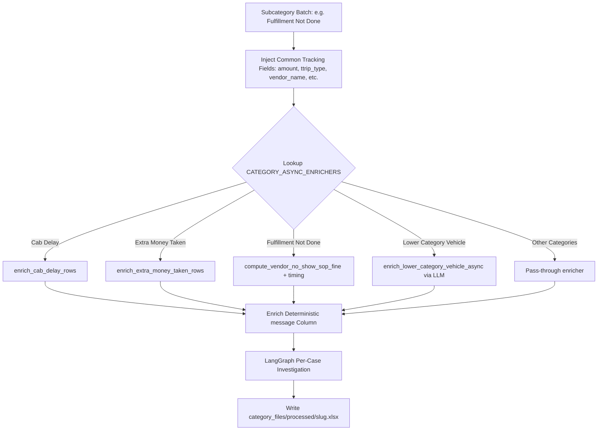

# Category Processors & SOP Fine Engine

This document provides a detailed specification of the category processing registry, asynchronous enrichment workers, common tracking columns, and the Vendor No Show Standard Operating Procedure (SOP) fine calculation engine.

---

## 1. Category Processor Architecture

Category processing operates on independent subcategory slices created by `split_by_subcategory`. Each batch executes asynchronously through two registries defined in `backend/app/domain/category_processors.py`:

1. **`CATEGORY_ASYNC_ENRICHERS`**: Asynchronous worker functions that compute domain-specific columns.
2. **`CATEGORY_PROCESSORS`**: Schema specifications defining the required output column ordering for each category's processed workbook.



---

## 2. Common Tracking Fields (All Categories)

Every processed category workbook contains the standard base columns from the uploaded dataset, plus comprehensive live tracking attributes injected via `enrich_common_tracking_fields(...)` (`backend/app/domain/tracking_common.py`):

### Complaint Metadata
- `complaint_against`: Constant `"dispatch_id"`.
- `complaint_against_id`: Value of `dispatch_id` from live tracking.
- `title`: Constant `"Service Issue"`.
- `vendor_name`: Vendor display name resolved from `incabs_suppliers`.

### Financial & Trip Parameters
- `amount`: Booking gross fare from live tracking.
- `ttrip_type`: Canonical trip type (e.g. `airport`, `local`, `outstation`).
- `supplier_id`: Supplier ID resolved from tracking rows.
- `comments`: Customer call transcripts from Redash.
- **Detailed Fare Elements:** `base_amount`, `amount_paid`, `cash_collected`, `per_km_rate`, `total_distance`, `extra_travelled`, `extra_travelled_fare`, `route_toll_charges`, `toll_charges`, `toll_paid`, `parking_charges`, `state_tax`, `airport_entry_fee`, `night_charges`, `waiting_charges`, `driver_charge_per_day`, `total_driver_charge`.

---

## 3. Vendor No Show & Fulfillment Not Done SOP Fine Engine

The business policy mandates that penalties for driver no-shows must follow strict SOP formulas rather than ad-hoc compensation amounts. This is governed by `backend/app/domain/fulfillment_not_done.py`.

### A. Mathematical Formula

Let $A$ be the booking gross fare (`amount`) and $T$ be the trip type (`ttrip_type`):

1. **Airport / Local Trips ($T \in \{\text{"airport"}, \text{"local"}\}$):**
   $$\text{Fine} = \min\left(0.50 \times A,\; 500\right)$$
2. **Other Trip Types (e.g. Outstation / Intercity):**
   $$\text{Fine} = \min\left(0.25 \times A,\; 2000\right)$$

### B. Rounding Specification (ROUND_HALF_UP)

To prevent fractional paise discrepancies in financial systems, the result is quantized to the nearest integer using Python's `decimal` module with `ROUND_HALF_UP`:

```python
def _round_half_up_to_int(value: Decimal) -> float:
    return float(value.quantize(Decimal("1"), rounding=ROUND_HALF_UP))
```
*Example:* ₹125.50 rounds to ₹126.00; ₹125.49 rounds to ₹125.00.

### C. Missing Data & Fallback Rules

If `amount` is missing, $\le 0$, or unparseable, or if `ttrip_type` is blank/empty:
1. `sop_fine` evaluates to `None`.
2. `fine_before_sop` records the original QlikSense `Recoverable` amount.
3. `fine_after_sop` is set to blank (`""`).
4. `sop_calculation_failed` is set to `True`.
5. The original `Recoverable` amount is preserved (not overwritten).
6. **Edit Stage Routing:** The case is routed directly to the **`needs_check`** edit bucket with the explicit user-facing reason:
   > *"Vendor No Show SOP fine could not be computed (missing amount or ttrip_type)."*

### D. Computable SOP Path

When both $A$ and $T$ are present:
1. `fine_before_sop` records the original QlikSense `Recoverable` amount.
2. `fine_after_sop` records the computed integer SOP fine.
3. `Recoverable` is overwritten with the computed SOP fine.
4. `sop_calculation_failed` is set to `False`.

### E. Packaging Invariant

The columns `fine_before_sop` and `fine_after_sop` are added to the processed category file (`category_files/processed/fulfillment-not-done.xlsx`) and exposed on the Edit UI. However, they are **never added to `final_output.xlsx`**. In `final_output.xlsx`, the final `fine` column contains the post-SOP (or human-edited) `Recoverable` amount.

---

## 4. Subcategory-Specific Enrichers

### A. Cab Delay Enrichment (`cab_delay_enrichment.py`)
In addition to common tracking, Cab Delay rows are enriched with:
- `booking status` & `tracking status`
- `preferred start time of customer (IST)` (converted from UTC `start_time`)
- `driver_started` & `driver_arrived` (IST timestamps)
- `pickup_time` & `drop_time`
- `total_distance` & `extra_travelled`

### B. Extra Money Taken Enrichment (`extra_money_taken.py`)
Enriches rows with toll, cash, and parking tracking attributes:
- `booking status` & `tracking status`
- `cash_collected`
- `extra_travelled_fare`
- `toll_charges` & `toll_paid`
- `parking_charges` & `night_charges`
- `state_tax`

### C. Lower Category Vehicle Enrichment (`lower_category_vehicle.py`)
Identifies vehicle downgrade complaints (e.g. customer booked an SUV but received a Hatchback):
- Injects vehicle booked from tracking: `vehicle_subcategory`, `vehicle_type`.
- Calls Azure OpenAI with prompt `build_lower_category_vehicle_prompt` on the Redash call transcript to extract:
  - `Customer Booked Vehicle`
  - `Customer Received Vehicle`
- Tagged with LLM purpose `"lower_category_vehicle"` for token accounting.
- If the LLM call fails, the booking logs a warning and proceeds without crashing.

---

## 5. Concurrency & Fault Tolerance

Category processing concurrency is governed by `CATEGORY_PROCESSING_CONCURRENCY` (default `4`).

```python
semaphore = asyncio.Semaphore(category_concurrency)
tasks = [
    asyncio.create_task(process_category_for_package(..., semaphore=semaphore))
    for batch in category_batches
]
```

### Fallback on Exception
If an unhandled error occurs during any enricher:
1. A fallback DataFrame is produced containing common tracking fields and deterministic `message`.
2. LangGraph per-case investigation executes over the fallback DataFrame.
3. A warning `category_processing_failed` is emitted listing the affected `Booking ID`s.
4. A pass-through processed workbook is written so the overall pipeline does not crash.

