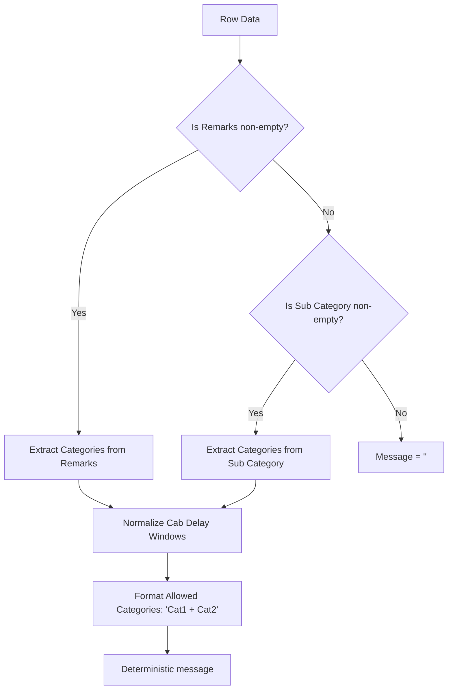

# Complaint Mapping & Deterministic Message Synthesis

This document specifies the complaint category taxonomy, alias dictionary, regex pattern-matching rules, duration extractors, and deterministic `message` synthesis engine implemented in `backend/app/domain/complaint_message.py`.

---

## 1. The 15 Canonical Allowed Categories

The system strictly enforces an allow-list of 15 canonical complaint categories. No free-form category labels or LLM inventions are permitted in the final `message` column:

```python
ALLOWED_COMPLAINT_CATEGORIES = [
    "AC Not Working",
    "Accident on the Way",
    "Bad Driver Behaviour/Skill",
    "Cab Breakdown",
    "Cab Delay",
    "Cab Delayed > 15 Minutes",
    "Cab Delayed by 30-60 Minutes",
    "Cab Delayed > 1 Hour",
    "Chauffeur/Vehicle Change",
    "Drunk Driver",
    "Extra Money Taken",
    "Low Category Vehicle",
    "Poor Vehicle Condition",
    "Vendor No Show",
    "White Number Plate",
]
```

---

## 2. Deterministic Precedence & Priority

The complaint message that appears in `final_output.xlsx` and vendor communications is generated deterministically using `build_message_from_row(*, remarks, sub_category)`:



### Policy Invariant: Prohibition of Call Comments in `message`
Customer call transcripts from Redash frequently include emotional descriptions, unrelated service remarks, or conflicting claims. Under business policy:
- **Call comments are NEVER used to build or modify the `message` column.**
- The source priority is strictly **Remarks $\rightarrow$ Sub Category**.
- Call comments are reserved solely for display in the UI and as supporting evidence in LangGraph agent tools.

---

## 3. Alias Dictionary & Normalization Rules

Text is normalized via `normalize_category_key`: converts to lower case, expands `&` to `" and "`, and strips punctuation.

### Canonical Aliases (`_ALIASES`)

The engine maintains an extensive alias lookup table:

| Input Text / Raw Alias | Canonical Allowed Category |
| :--- | :--- |
| `fulfillment not done`, `fulfilment not done`, `no show` | **Vendor No Show** |
| `details change`, `driver change`, `vehicle change`, `chauffeur change` | **Chauffeur/Vehicle Change** |
| `lower category vehicle` | **Low Category Vehicle** |
| `air conditioning not working`, `a c not working`, `ac issue` | **AC Not Working** |
| `accident on way`, `accidental case` | **Accident on the Way** |
| `bad driver behavior`, `driver behaviour`, `driver skill` | **Bad Driver Behaviour/Skill** |
| `car breakdown`, `vehicle breakdown` | **Cab Breakdown** |
| `extra cash`, `extra money` | **Extra Money Taken** |
| `bad vehicle condition`, `dirty vehicle` | **Poor Vehicle Condition** |
| `private number plate`, `white plate` | **White Number Plate** |

### Fuzzy Matching Fallback
If an exact alias match fails, the token is evaluated using `difflib.get_close_matches` against both canonical categories and all known aliases with a strict similarity cutoff of `0.72`. This accommodates minor typos (e.g. `"fulfillment not doen"` safely maps to `"Vendor No Show"`).

---

## 4. Free-Text Pattern Inference

When text does not match an explicit category name, `infer_categories_from_text(...)` applies regex pattern matching:

- **AC Issues:** `\b(?:a\s*/?\s*c|ac|air condition(?:er|ing)?)\b.*\b(?:not working|failed|issue|problem)\b` $\rightarrow$ `AC Not Working`
- **Accidents:** `\b(?:accident|crash|collision)\b` $\rightarrow$ `Accident on the Way`
- **Driver Conduct:** `\b(?:rude|misbehav|abusive|rash|unsafe|bad driver|driver skill|driver behaviour)\b` $\rightarrow$ `Bad Driver Behaviour/Skill`
- **Breakdown:** `\b(?:breakdown|broke down|vehicle stopped|cab stopped|car stopped)\b` $\rightarrow$ `Cab Breakdown`
- **Details Change:** `\b(?:chauffeur change|driver change|vehicle change|cab change|details change)\b` $\rightarrow$ `Chauffeur/Vehicle Change`
- **Intoxication:** `\b(?:drunk|intoxicated|alcohol)\b` $\rightarrow$ `Drunk Driver`
- **Overcharging:** `\b(?:extra money|extra cash|collected extra|charged extra|toll and parking)\b` $\rightarrow$ `Extra Money Taken`
- **Vehicle Downgrade:** `\b(?:low category|lower category|downgrad|booked .* received)\b` $\rightarrow$ `Low Category Vehicle`
- **Poor Vehicle:** `\b(?:poor vehicle condition|dirty|unclean|damaged|smell|stink)\b` $\rightarrow$ `Poor Vehicle Condition`
- **Driver No Show:** `\b(?:vendor no show|no show|cab did not arrive|cab didn t arrive)\b` $\rightarrow$ `Vendor No Show`
- **Private Plate:** `\b(?:white number plate|private number plate|white plate)\b` $\rightarrow$ `White Number Plate`

---

## 5. Cab Delay Window Duration Extraction

The Cab Delay family contains four granular categories:
- `Cab Delay` (general/unspecified)
- `Cab Delayed > 15 Minutes`
- `Cab Delayed by 30-60 Minutes`
- `Cab Delayed > 1 Hour`

### Duration Parsing Logic (`classify_cab_delay_window`)

1. **Delay Presence Check:** Scans for keywords: `delay`, `delayed`, `late`, `waiting`, `waited`.
2. **Numeric Extraction (`extract_delay_durations_minutes`):**
   - Extracts combined hours and minutes: `r"(\d+(?:\.\d+)?)\s*(?:hr|hrs|hour)\s*(\d+)\s*(?:min|mins)"` $\rightarrow (\text{hr} \times 60) + \text{min}$.
   - Extracts standalone minutes and hours.
3. **Window Assignment Hierarchy:**
   - **`Cab Delayed > 1 Hour`**: If explicit text matches `> 1 hr`, `> 60 mins`, `more than 1 hour`, or any duration $> 60$.
   - **`Cab Delayed by 30-60 Minutes`**: If text matches `30 to 60 min`, `half an hour`, `one hour`, or duration is between 30 and 60 minutes inclusive.
   - **`Cab Delayed > 15 Minutes`**: If text matches `> 15 mins`, `more than 15 mins`, or duration $> 15$.
   - **`Cab Delay`**: Fallback when delay is mentioned without a quantifiable duration.

### Delay Selection Normalization (`normalize_cab_delay_selection`)
If multiple delay categories are identified (e.g. `Cab Delay` and `Cab Delayed > 1 Hour`), they are collapsed to the **single most specific duration window**.

---

## 6. Output Message Synthesis

The final message string is produced via `format_message_categories(categories: list[str]) -> str`:
- Sorts matching categories in the canonical order defined in `ALLOWED_COMPLAINT_CATEGORIES`.
- Removes duplicates.
- Joins them using the separator `" + "`.

**Examples:**
- Remarks `"cab broke down and AC not working"` $\rightarrow$ `"AC Not Working + Cab Breakdown"`
- Remarks `"vendor no show"` with Sub Category `"Fulfillment Not Done"` $\rightarrow$ `"Vendor No Show"`
- Remarks `"Driver was 45 mins late"` $\rightarrow$ `"Cab Delayed by 30-60 Minutes"`

