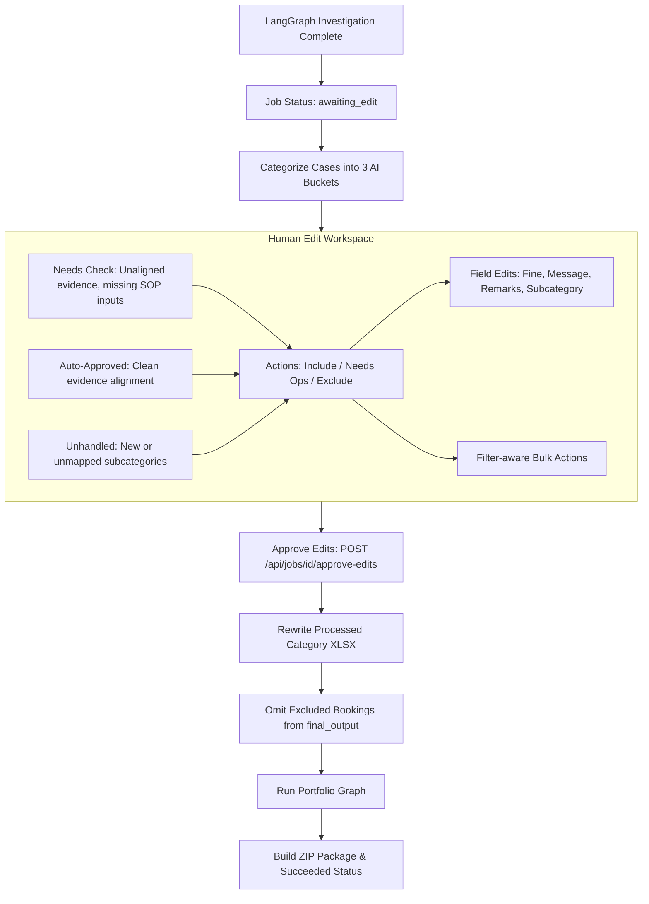

# Human Edit Workspace & Decision Stage

This document details the production human-in-the-loop (HITL) editing stage implemented in `backend/app/services/edit_cases.py`, `backend/app/services/pipeline.py`, and `frontend/src/pages/JobEditPage.tsx`.

---

## 1. Overview of the Edit Stage

In production API jobs, the pipeline runs with `enable_hitl=False` inside the graph and pauses at status **`awaiting_edit`**. This guarantees that human operators have complete governance over every recovery penalty before final workbooks, portfolio metrics, or vendor emails are generated.



---

## 2. The 3 AI Buckets

Cases are deterministically routed into three distinct operational buckets (`resolve_edit_bucket` in `backend/app/services/edit_cases.py`):

| AI Bucket | Qualification Criteria | Default Outcome | UI Purpose |
| :--- | :--- | :--- | :--- |
| **`needs_check`** | • Vendor No Show missing `amount` or `ttrip_type`.<br>• Remarks absent with mapped Sub Category.<br>• Review status is `needs_review`, `missing_evidence`, `contradiction`, or `failed`. | `needs_ops` | Flagged cases requiring operational verification before inclusion. |
| **`auto_approved`** | • Remarks present and mapped to canonical category.<br>• Review status is `auto_ready`.<br>• All required SOP inputs present. | `include` | High-confidence cases ready for recovery packaging. |
| **`unhandled`** | • Sub Category is absent or placeholder `Uncategorized`.<br>• Sub Category is not in the allowed complaint list. | `needs_ops` | New or unrecognized complaint categories needing ops reclassification. |

### Deterministic Bucket Precedence Logic
```python
def resolve_edit_bucket(review_status, sub_category, remarks, case=None):
    # 1. Both absent
    if sub_absent and remarks_absent:
        return ("unhandled", "Remarks and Sub Category are absent.")
    # 2. Subcategory absent
    if sub_absent and not remarks_absent:
        return ("unhandled", "Remarks present but Sub Category is absent (Uncategorized).")
    # 3. Unmapped subcategory
    if not map_complaint_labels(sub_category):
        return ("unhandled", f"Sub Category '{sub_category}' is new/unique and not allowed.")
    # 4. Missing SOP inputs for Vendor No Show
    if case and vendor_no_show_sop_missing(case):
        return ("needs_check", "Vendor No Show SOP fine could not be computed (missing amount or ttrip_type).")
    # 5. Missing Remarks
    if remarks_absent:
        return ("needs_check", "Remarks are absent; message was generated from Sub Category.")
    # 6. Follow agent review status
    if review_status in AUTO_APPROVED_STATUSES:
        return ("auto_approved", "")
    return ("needs_check", case.get("review_reason", ""))
```

---

## 3. Edit Outcomes & Downstream Impact

Every case has an assigned `edit_outcome`:

### 1. `include` (Ready for Recovery)
- **Review Status:** Promoted to `auto_ready`.
- **Decision:** Set to `valid_penalty`.
- **Amount:** Set to the edited `recoverable_amount`.
- **Output:** Included in `final_output.xlsx` and included in portfolio recoverable totals.

### 2. `needs_ops` (Requires Follow-up)
- **Review Status:** Set to `needs_review`.
- **Decision:** Set to `needs_review`.
- **Amount:** Retains `recoverable_amount`.
- **Output:** Included in `final_output.xlsx` and logged in `review_queue.xlsx`.

### 3. `exclude` (Discard from Penalty)
- **Review Status:** Flagged as `excluded = True`.
- **Decision:** Set to `excluded`.
- **Amount:** Zeroed out (`recoverable_amount = 0`, `_portfolio_omit = True`).
- **Output:**
  - **Completely omitted from `final_output.xlsx`** (filtered out).
  - Omitted from portfolio recovery totals and vendor penalty rankings.
  - Preserved in `agent_audit.xlsx` with `excluded = true` for historical auditing.

---

## 4. Field Editing Permissions

To prevent corruption of live database records, fields are strictly segregated into editable and read-only attributes:

### Editable Fields
- `recoverable_amount`: Fine after SOP (must be finite number $\ge 0$).
- `message`: Complaint message string.
- `remarks`: Operational remarks text.
- `sub_category`: Complaint subcategory (must be non-empty string).
- `edit_outcome`: Selected action (`include`, `needs_ops`, `exclude`).

### Read-Only Fields (Display Only)
- `booking_id`: Unique booking reference.
- `comments`: Customer call transcript from Redash.
- `vendor_name`: Resolved supplier/vendor name.
- `amount`: Gross booking fare from live tracking.
- `ttrip_type`: Live tracking trip type.
- `fine_before_sop`: Original recoverable amount from QlikSense before SOP fine calculation.

---

## 5. REST Endpoints for the Edit Stage

### A. List Edit Cases
```http
GET /api/jobs/{job_id}/edit-cases?page=1&bucket=needs_check&sub_category=Cab%20Delay
```
- Supports filtering by `bucket` (`needs_check`, `auto_approved`, `unhandled`), `booking_id`, and `sub_category`.
- Returns paginated `cases`, metric counts, and a list of `available_sub_categories` scoped to the bucket.

### B. Patch Individual Case
```http
PATCH /api/jobs/{job_id}/edit-cases/{booking_id}
Content-Type: application/json

{
  "recoverable_amount": 500.0,
  "edit_outcome": "include",
  "message": "Vendor No Show"
}
```
- Validates data types and recalculates change flags (`was_edited = true`, `edited_fields = ["recoverable_amount", "edit_outcome"]`).

### C. Bulk Patch Cases
```http
POST /api/jobs/{job_id}/edit-cases/bulk
Content-Type: application/json

{
  "bucket": "auto_approved",
  "edit_outcome": "include",
  "sub_category": "Cab Delay"
}
```
- Applies the specified `edit_outcome` across all cases in the targeted bucket.
- **Filter-Aware:** If `sub_category` or `booking_id` filters are provided, only matching cases within the bucket are updated.

### D. Approve Edits and Finalize
```http
POST /api/jobs/{job_id}/approve-edits
```
- Triggers `apply_edits_and_package`.
- Rewrites `category_files/processed/*.xlsx` with edited values.
- Filters out excluded cases and builds `final_output.xlsx`.
- Runs portfolio analysis graph and packages `agentic_loss_recovery_package.zip`.
- Transitions job to `succeeded`.

