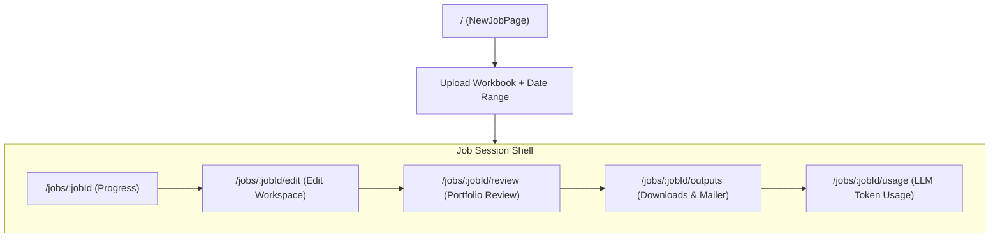
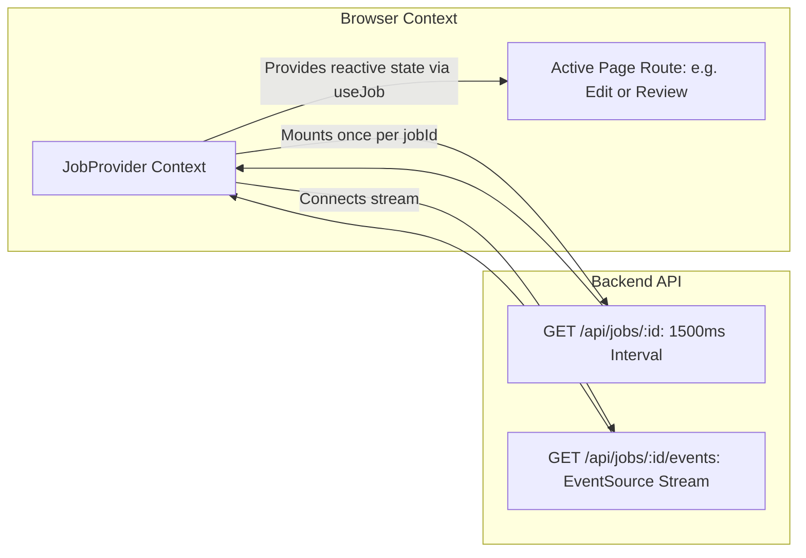

# Frontend Architecture & User Experience

This document details the Single-Page Application (SPA) architecture, state management, stage navigation guards, and component library implemented in `frontend/src/`.

---

## 1. Technology Stack

- **Framework:** **React 18** with **TypeScript** (Strict Mode enabled).
- **Build Tool:** **Vite 7** with Fast Refresh.
- **Routing:** **React Router v6** (declarative route tables and nested stage outlets).
- **Visuals & Icons:** **Lucide React** icon primitives.
- **Diagrams:** **Mermaid.js** via custom `MermaidDiagram` component.
- **Styling:** Modular vanilla CSS (`frontend/src/styles.css`) utilizing modern CSS variables, CSS Grid, and responsive flexboxes.

---

## 2. Route Table & Stage Stepper

The route table is declared in `frontend/src/App.tsx`:



### Locked Stage Navigation Guards (`JobLayout.tsx`)
Stages unlock progressively based on the job's server lifecycle status:

```typescript
function stageDisabledReason(key: StageKey, flags): string | null {
  if (key === "progress") return null;
  if (flags.hasFailed) return "Job failed — start a new job";
  if (key === "edit" && !flags.showEditWorkspace) {
    return "Available after investigation finishes";
  }
  if (key === "review" && !flags.showAgentWorkspace) {
    return "Available after you approve edits";
  }
  if ((key === "outputs" || key === "usage") && !flags.isComplete) {
    return "Available after the job succeeds";
  }
  return null;
}
```

---

## 3. Session State Management (`JobProvider.tsx`)

A critical architectural requirement is that **background polling and Server-Sent Events (SSE) subscriptions must survive user navigation between stage tabs**.



### Custom Hooks
1. **`useJobSession(jobId)`**:
   - Manages dual-mode updates: Polling every 1500ms while running, combined with real-time SSE stream ingestion from `/api/jobs/{id}/events`.
   - Derives reactive convenience flags: `isComplete`, `showEditWorkspace`, `showAgentWorkspace`, `hasFailed`.
2. **`useJob()`**:
   - Exposes job snapshot, event logs, and status mutating callbacks to any child component within `/jobs/:jobId`.
3. **`useCreateJob()`**:
   - Manages multipart file upload validation, date range validation, and creation requests on `NewJobPage`.

---

## 4. Page Specifications

### A. New Job Page (`NewJobPage.tsx`)
- Drag-and-drop file upload zone accepting `.xlsx` and `.xls`.
- Date range selectors (`start_date` and `end_date`) in ISO format.
- "Process full workbook" toggle (`process_all=true`) to bypass date range restrictions.
- Submits form to `POST /api/jobs` and redirects directly to `/jobs/{job_id}`.

### B. Job Progress Page (`JobProgressPage.tsx`)
- **Executive Progress Bar:** Visualizes the 8 investigation stages (`intake` $\rightarrow$ `evidence` $\rightarrow$ `specialist` $\rightarrow$ `judge` $\rightarrow$ `finalize`).
- **Category Progress Cards:** Real-time completion progress per subcategory batch.
- **Warnings List:** Prominently alerts operators if bookings were discarded due to missing `supplier_id` or absent tracking.
- **Technical Log Drawer:** Collapsible technical view displaying raw SSE graph events for debugging.

### C. Human Edit Workspace (`JobEditPage.tsx`)
The operational core where human operators review and approve recovery penalties:
- **Bucket Navigation Tabs:** Switches between `Needs check`, `Auto-approved`, and `New–unique categories (Unhandled)`.
- **Search & Filters:** Real-time search by `Booking ID` and scoped subcategory dropdown.
- **Bulk Action Header:** Filter-aware bulk buttons (`Bulk include`, `Bulk needs ops`, `Bulk exclude`) that apply outcomes to all matching cases in the bucket.
- **Individual Case Card (`EditCaseCard.tsx`):**
  - Displays read-only tracking attributes: Booking ID, Call comments, Vendor name, Gross fare, Trip type, Fine before SOP.
  - Interactive inputs: Editable Fine (post-SOP recoverable), Message string, Remarks, Sub Category.
  - One-click outcome selector: `Include`, `Needs ops`, `Exclude`.
  - Displays explicit AI reasoning for bucket placement (e.g., *"Vendor No Show SOP fine could not be computed"*).
- **Approval CTA:** "Approve edits and package" triggers `POST /api/jobs/{id}/approve-edits` and unlocks the Review page.

### D. Job Review Page (`JobReviewPage.tsx`)
Aggregate post-edit recovery analysis (no per-case approvals):
- **Executive KPI Cards:** Total Recoverable Amount, High-Confidence Amount, Finalized Case Count.
- **Top Complaint Drivers:** Category distribution chart.
- **Top Vendors by Penalty:** Ranked list of vendors with penalty counts and totals.
- **Recommended Operational Actions:** Automated policy guidance generated by the portfolio graph.

### E. Job Outputs Page (`JobOutputsPage.tsx`)
- **Download Cards:** Direct downloads for `agentic_loss_recovery_package.zip`, `final_output.xlsx`, `agent_audit.xlsx`, `review_queue.xlsx`, and category workbooks.
- **Paginated Previews:** Embedded preview table for `final_output.xlsx` with booking search.
- **Vendor Penalty Mailer Panel (`VendorMailerPanel.tsx`):**
  - Previews generated email drafts.
  - Renders recipient email, subject line, bold HTML table preview, and transcript snippet.
  - "Send mail to vendor" button dispatches frozen drafts once via SMTP.

### F. Job Usage Page (`JobUsagePage.tsx`)
- Unlocked after job completion.
- Visualizes total LLM token usage (prompt, completion, cached) and calculated financial costs in USD.
- Breakdown table by purpose (`specialist`, `judge`, `source_alignment`, `lower_category_vehicle`, `portfolio`).

