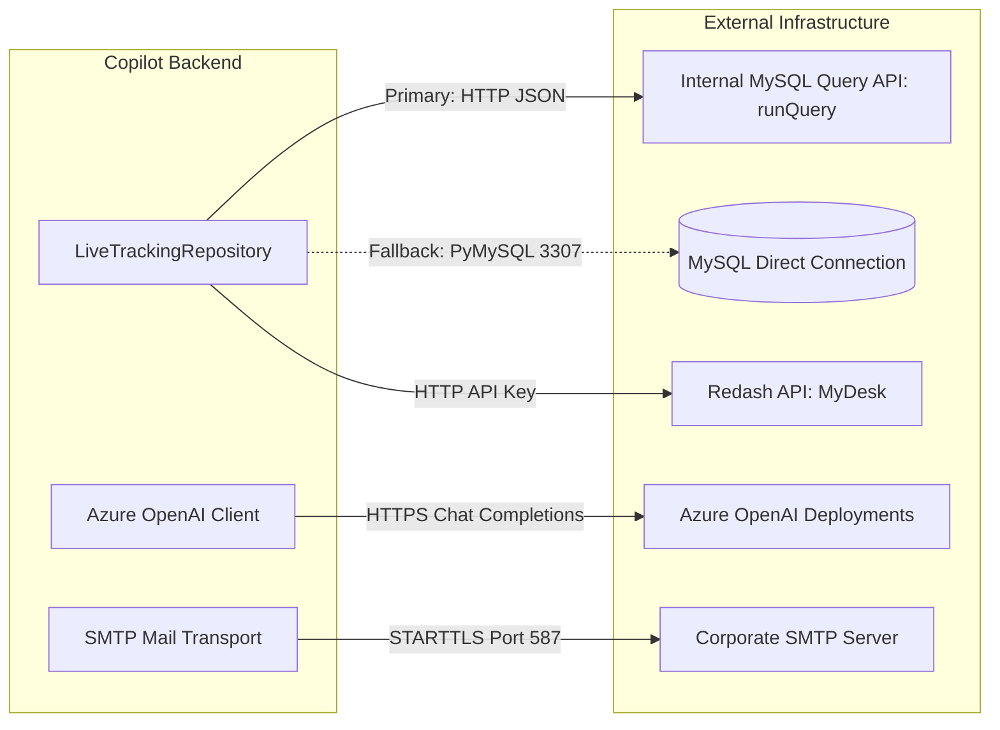

# External Integrations & Data Repositories

This document details the configuration, communication protocols, query logic, and failure handling for all external services integrated into **Agentic Loss Recovery Copilot**.

---

## 1. Overview of External Integrations



---

## 2. MySQL Live Tracking Integration

The application queries two tables to assemble comprehensive tracking data:
1. `tracking_reports_raw`: Booking lifecycle events, lat/long timestamps, driver assignments, and fares.
2. `incabs_suppliers`: Vendor identity lookup table mapping supplier IDs to vendor names.

### A. Primary Access: Internal MySQL HTTP Query API

Instead of direct database socket connections, the primary access mechanism executes read-only queries against an internal corporate HTTP service.

- **Endpoint URL:** `MYSQL_API_URL` (default: `http://cabs-incabs-ryde-reports.prd.mmt.internal/scripts/mysql/runQuery`)
- **HTTP Method:** `POST`
- **Request Headers:** `Content-Type: application/json`
- **Payload Schema:**
  ```json
  {
    "dbname": "incabs_blocks_and_confirms",
    "query": "SELECT ... FROM tracking_reports_raw WHERE order_reference_number IN ('...')"
  }
  ```
- **Response Schema:**
  ```json
  {
    "success": true,
    "data": [
      {
        "dispatch_id": "DSP123456",
        "order_reference_number": "MMT1001",
        "supplier_id": "SUP99",
        "ttrip_type": "airport",
        "amount": 1250.0
      }
    ],
    "message": ""
  }
  ```
- **Retry & Backoff Policy:**
  - Implemented in `execute_mysql_api_query(...)` with up to 3 attempts.
  - Exponential backoff delay: `0.5 * (2 ** (attempt - 1))` seconds.
  - Immediate failure on SQL syntax/semantic errors (no useless retry).
  - Raises `MysqlApiError` if all attempts fail or HTTP status is $\ge 500$.

### B. Legacy Fallback: Direct PyMySQL Connection

If `MYSQL_API_URL` is omitted or empty, the application falls back to direct database pooling:
- **Host / Port:** `MYSQL_HOST` (`10.212.92.159`) / `MYSQL_PORT` (`3307`)
- **Credentials:** `MYSQL_USER` (`incabs_blocks_and_confirms_stg`), `MYSQL_PASSWORD`
- **Database:** `MYSQL_DATABASE` (`incabs_blocks_and_confirms`)
- **Driver:** `pymysql` with `DictCursor`, connect timeout of 15 seconds, read timeout of 120 seconds.

### C. Supplier Join & Vendor Name Resolution

Every tracking record references one or more supplier IDs:
- Lookup columns inspected on tracking rows: `supplier_id`, `original_supplier_id`, `detached_supplier_id`.
- Function: `fetch_supplier_vendor_names(...)`
- Query:
  ```sql
  SELECT oid, on_final 
  FROM incabs_suppliers 
  WHERE oid IN ('<id1>', '<id2>', ...)
  ```
- Result: Mapped onto tracking rows as `vendor_name = on_final`.

### D. Column Pruning & Noise Elimination

`tracking_reports_raw` contains over 100 columns. The ingestion pipeline prunes unhelpful columns to optimize memory:
1. Filters against `CURATED_TRACKING_COLUMNS` (56 essential fields).
2. `prune_unhelpful_columns`: Dynamically strips columns where 100% of rows contain noise values (`0`, `0.0`, `false`, `none`, `nan`, `nat`).
3. Core identifiers are protected and never pruned: `dispatch_id`, `order_reference_number`, `ref_number`.

---

## 3. Redash Call Comments Integration

Customer call transcripts (logged by customer support agents in MyDesk) are retrieved to provide ground-truth evidence during investigation.

- **Host:** `REDASH_HOST` (default: `http://common-redash.mmt.com`)
- **API Key:** `REDASH_API_KEY`
- **Data Source IDs:** `REDASH_SOURCE_IDS` (default: `10`, representing MyDesk / vortex call tables)
- **Batch Size:** `REDASH_BATCH_SIZE` (default: `250` booking IDs per query)
- **Module:** `backend/app/integrations/redash_call_comments.py`
- **Function:** `fetch_call_comments_for_booking_ids(...)`
  - Batches `Booking ID`s into parameterized queries.
  - Aggregates multi-agent notes and customer transcripts per booking.
- **Graceful Degradation:**
  - If `REDASH_API_KEY` is not provided, the pipeline logs an informational notice and continues.
  - The `comments` column remains empty, and investigations proceed using `Remarks` and `Sub Category`.

---

## 4. Azure OpenAI Integration

Used by the category enrichers (e.g. vehicle downgrade extraction) and the LangGraph multi-agent investigation system.

- **Configuration:**
  - `AZURE_OPENAI_CHAT_COMPLETIONS_URL`: Full endpoint URL including API version and deployment name.
  - `AZURE_OPENAI_API_KEY`: Secret authentication key.
- **Client Implementation:**
  - Synchronous: `call_azure_openai_sync(prompt, ...)`
  - Asynchronous: `call_azure_openai_async(prompt, ...)`
  - Native LangChain Adapter: `backend/app/agents/langchain_model.py` creates an `AzureChatOpenAI` instance configured with the same credentials.
- **Concurrency & Token Accounting:**
  - Requests are throttled using `asyncio.Semaphore(LLM_CONCURRENCY)`.
  - Every call is instrumented via `bind_usage_recorder` to capture prompt tokens, completion tokens, cached tokens, and financial cost.

---

## 5. Enterprise SMTP Vendor Mailer Integration

The vendor penalty mailer dispatches penalty notifications to vendor managers via enterprise email.

- **Host & Port:** `SMTP_HOST` (`smtpmail.mmt.com`) / `SMTP_PORT` (`587`)
- **Authentication:** `SMTP_USER` (`noreply-depot@makemytrip.com`) / `SMTP_PASSWORD`
- **Security Protocols:**
  - `SMTP_STARTTLS=true`: Upgrades plain connections to TLS.
  - `SMTP_TLS_VERIFY=false`: Configured specifically for `smtpmail.mmt.com` to accommodate internal enterprise certificate authorities (matches production Node.js/Nodemailer specifications).
- **Transport Interfaces (`backend/app/integrations/smtp.py`):**
  - `MailTransport` (Protocol): Abstract interface with `send_mail(mail: OutboundMail)`.
  - `SmtpMailTransport`: Production SMTP implementation utilizing Python's `smtplib.SMTP`.
  - `InMemoryMailTransport`: Test fixture simulating deliveries and verifying recipients, subjects, and HTML table formatting without network traffic.
- **Error Handling:**
  - Transport failures raise `SmtpError`.
  - Mailer dispatch isolates failures per recipient; if 1 of 3 recipients fails, the job records status `partial` without crashing the service.

