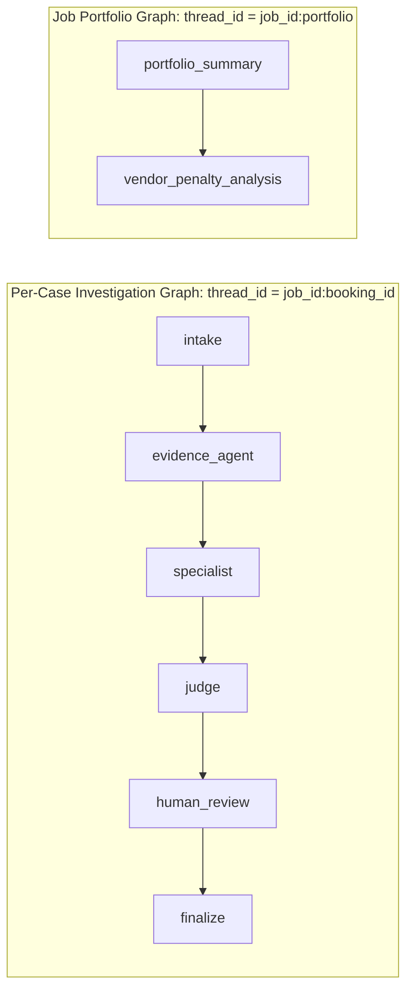
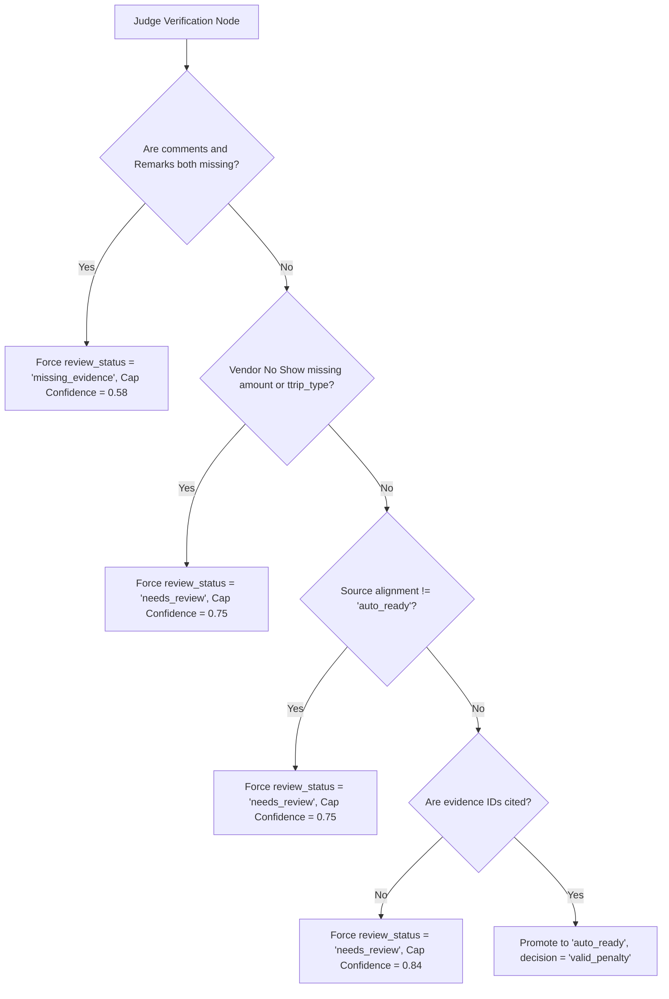

# LangGraph Multi-Agent Investigation System

This document specifies the architecture, state definitions, agent topology, evidence tools, specialist roles, judge guardrails, and streaming infrastructure of the LangGraph investigation layer in `backend/app/agents/`.

---

## 1. Architectural Boundary

LangGraph is responsible exclusively for **evidence gathering, policy reasoning, specialist review, judge verification, and portfolio aggregation**.

### Explicitly Excluded from LangGraph
To guarantee deterministic execution and high throughput, the following operations run **outside** the graph in standard Python/Pandas services:
- Excel ingestion, date filtering, CARBD filtering, zero-recoverable filtering, and deduplication.
- Live MySQL tracking reports and Redash call comments retrieval.
- Category batch splitting and subcategory enrichers (`CATEGORY_ASYNC_ENRICHERS`).
- Vendor No Show SOP fine calculations and deterministic `message` column generation.

---

## 2. Graph Topologies



### A. Per-Case Investigation Graph
- **Thread ID Format:** `"{job_id}:{booking_id}"`
- **Nodes:**
  1. `intake`: Normalizes case fields, sets up tracking context, and creates initial trace records.
  2. `evidence_agent`: Executes evidence tools (`get_comments`, `get_remarks`, `get_sub_category`, `get_source_alignment`, `get_tracking_context`, `get_vendor_context`).
  3. `specialist`: Routes to a category-specific specialist agent to evaluate evidence and formulate a penalty recommendation.
  4. `judge`: Independent verification agent enforcing deterministic guardrails, cross-checking evidence citations, and preventing hallucinations.
  5. `human_review`: In production API jobs (`enable_hitl=False`), this node acts as a pass-through. (In test suites with `enable_hitl=True`, it pauses via LangGraph `interrupt()`).
  6. `finalize`: Compiles immutable case records, attaches tool call logs, and produces output payloads.

### B. Portfolio Analysis Graph
- **Thread ID Format:** `"{job_id}:portfolio"`
- **Nodes:**
  1. `portfolio_summary`: Synthesizes executive commentary, complaint hotspot clusters, and systemic driver analysis across all approved cases.
  2. `vendor_penalty_analysis`: Aggregates vendor rankings, financial penalty distribution, and operational action recommendations.

---

## 3. Investigation State Schema

The state passed across nodes is governed by `InvestigationState` (`backend/app/agents/state.py`):

```python
class InvestigationState(TypedDict, total=False):
    booking_id: str
    sub_category: str
    remarks: str
    recoverable_amount: float
    row_index: int
    comments: str
    message: str
    vendor_name: str
    amount: float | None
    ttrip_type: str
    fine_before_sop: float | None
    fine_after_sop: float | None
    sop_calculation_failed: bool
    source_analysis: dict[str, Any]
    tracking_context: dict[str, Any]
    evidence: list[dict[str, Any]]
    tool_calls: list[dict[str, Any]]
    specialist_decision: dict[str, Any]
    judge_decision: dict[str, Any]
    human_decision: dict[str, Any]
    final_decision: dict[str, Any]
    trace: list[dict[str, Any]]
    pending_interrupt: bool
    case_payload: dict[str, Any]
```

---

## 4. Evidence Tools Registry

The `evidence_agent` node invokes 6 specialized tools defined in `backend/app/agents/tools.py` using `langgraph.prebuilt.InjectedState`:

| Tool Name | Tool Purpose | Return Fields |
| :--- | :--- | :--- |
| `get_comments` | Retrieves customer call transcript from Redash. | `text`, evidence status (`available` or `missing`). |
| `get_remarks` | Retrieves QlikSense Remarks logged by ops. | `text`, evidence status (`available` or `missing`). |
| `get_sub_category` | Retrieves row subcategory context. | `text`, row subcategory. |
| `get_source_alignment` | Evaluates alignment between Remarks and Sub Category. | Primary source, source categories, alignment status (`auto_ready`, `needs_review`, `missing_evidence`). |
| `get_tracking_context` | Inspects live GPS timestamps, trip status, and fares. | Pickup/drop timestamps, driver started/arrived, fare, car type. |
| `get_vendor_context` | Inspects vendor and supplier identity. | `vendor_name`, `supplier_id`. |

### Evidence Policy Invariants
- **Primary Category Source:** Remarks $\rightarrow$ Sub Category (when mapped).
- **Call Comments Role:** Call comments are supporting evidence only; they **never** dictate the primary category or override Remarks.
- **Supporting Context Only:** Tracking and vendor context support the investigation but cannot alone justify a penalty if source text is contradictory.

---

## 5. Specialist Agents & Routing

Cases are routed dynamically based on complaint category via `AGENT_BY_CATEGORY`:

- `Cab Delay Agent`: Evaluates late arrivals and duration thresholds.
- `Extra Money Taken Agent`: Evaluates driver overcharging, cash collection, and toll/parking disputes.
- `Fulfillment Not Done Agent`: Evaluates driver no-shows and SOP compliance.
- `Lower Category Vehicle Agent`: Evaluates vehicle downgrade claims.
- `Driver Behavior Agent`: Evaluates rash driving, rude behavior, and intoxication.
- `Details Change Agent`: Evaluates unannounced driver/cab changes.
- `Vehicle Condition Agent`: Evaluates cleanliness and AC/breakdown complaints.

### LLM Invocation Parameters
- Azure OpenAI Chat Completions endpoint.
- Reasoning effort: `"medium"`.
- Maximum completion tokens: `8192`.
- Fallback: If Azure OpenAI is unresponsive, the system gracefully falls back to deterministic rule-based policies (`build_specialist_decision`).

---

## 6. Judge Verification & Guardrail Engine

The `judge` agent provides an independent verification check. Regardless of LLM suggestions, deterministic guardrails in `policy.py` enforce strict safety constraints:



### Review Status Definitions
- **`auto_ready`**: Case is fully verified, source text aligns with row context, and evidence is cited.
- **`needs_review`**: Operational verification required (unmapped category, missing SOP inputs, or conflicting sources).
- **`missing_evidence`**: Critical source text (Remarks and comments) is entirely unavailable.
- **`contradiction`**: Evidence sources directly refute one another.
- **`failed`**: Uncaught exception during agent execution.

---

## 7. Streaming & Event Architecture

During investigation, nodes emit fine-grained custom events using `get_stream_writer()`:

```json
{
  "type": "node",
  "node": "specialist",
  "booking_id": "MMT12345",
  "status": "completed",
  "summary": "Specialist verified Vendor No Show"
}
```

- Events are buffered in `JobStore._graph_events` (retaining the latest 40 events).
- Streamed in real time to the frontend via `GET /api/jobs/{id}/events` (SSE).
- Compact executive stage progress is maintained in `job.investigation_summary` (powers the calm UI progress timeline).

