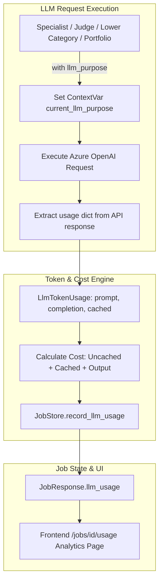

# LLM Token Usage & Cost Tracking

This document specifies the token accounting, purpose-based instrumentation, pricing rate configuration, and cost estimation engine implemented in `backend/app/integrations/llm_usage.py`, `backend/app/services/job_store.py`, and `frontend/src/pages/JobUsagePage.tsx`.

---

## 1. Overview & Architecture

To maintain complete transparency into operational AI expenses, the platform instruments every LLM request with granular token tracking. Token usage is categorized by functional purpose, aggregated in real time within `JobStore`, and displayed on the dedicated **Usage** page (`/jobs/{id}/usage`).



---

## 2. Purpose-Based Categorization

Every Azure OpenAI invocation is tagged using the `llm_purpose(purpose_name)` context manager. The system tracks 6 functional purposes:

| Purpose Key | Display Label | Component / Node | Description |
| :--- | :--- | :--- | :--- |
| **`specialist`** | Specialist | `specialist_node` | Category-specific agent reasoning over case evidence. |
| **`judge`** | Judge | `judge_node` | Independent judge verification and guardrail enforcement. |
| **`source_alignment`** | Source alignment | `evidence_agent_node` | Text-level category alignment between sources (if called). |
| **`lower_category_vehicle`** | Lower category vehicle | `_enrich_lower_category_vehicle_async` | Extracting booked vs. received vehicles from transcripts. |
| **`portfolio`** | Portfolio summary | `portfolio_summary_node` | Aggregate portfolio narrative and driver clustering. |
| **`unknown`** | Other | Miscellaneous | Uncategorized fallback calls. |

### Special Invariant: Zero LLM Mailer
The vendor penalty mailer graph is 100% deterministic and makes **zero LLM calls**. The usage report explicitly documents this with the note:
```json
"notes": ["Vendor mailer uses no LLM"]
```

---

## 3. Token Extraction & Caching

Implemented in `extract_usage(response_payload: dict) -> LlmTokenUsage`:

- **Prompt Tokens:** `usage.prompt_tokens`
- **Completion Tokens:** `usage.completion_tokens`
- **Total Tokens:** `usage.total_tokens` (or sum if zero)
- **Prompt Token Caching:** Extracted from `usage.prompt_tokens_details.cached_tokens`. When Azure OpenAI utilizes prompt prefix caching, cached input tokens are billed at a significantly reduced rate.

---

## 4. Pricing Configuration & Cost Formula

Pricing rates are configurable via environment variables in `.env` (rates expressed in USD per 1 Million tokens):

| Environment Variable | Default Value (USD / 1M tokens) | Description |
| :--- | :---: | :--- |
| `LLM_INPUT_USD_PER_1M` | **$1.25** | Standard uncached prompt input tokens. |
| `LLM_OUTPUT_USD_PER_1M` | **$10.00** | Completion output tokens. |
| `LLM_CACHED_INPUT_USD_PER_1M` | **$0.13** | Cached prompt input tokens. |
| `LLM_MODEL_NAME` | Auto-detected / `gpt-5` | Deployment model name parsed from the API URL. |

### Mathematical Cost Calculation Formula

Let $T_{\text{prompt}}$ be total prompt tokens, $T_{\text{cached}}$ be cached prompt tokens, and $T_{\text{comp}}$ be completion tokens:

1. **Uncached Prompt Tokens:**
   $$T_{\text{uncached}} = \max\left(0,\; T_{\text{prompt}} - T_{\text{cached}}\right)$$
2. **Estimated Cost ($):**
   $$\text{Cost} = \frac{\left(T_{\text{uncached}} \times R_{\text{input}}\right) + \left(T_{\text{cached}} \times R_{\text{cached}}\right) + \left(T_{\text{comp}} \times R_{\text{output}}\right)}{1,000,000}$$

The result is rounded to 6 decimal places for accounting precision.

---

## 5. Job Store Summary Schema (`LlmUsageSummary`)

Exposed via `GET /api/jobs/{id}`:

```json
{
  "model": "gpt-5",
  "pricing": {
    "input_usd_per_1m": 1.25,
    "output_usd_per_1m": 10.0,
    "cached_input_usd_per_1m": 0.13,
    "currency": "USD"
  },
  "totals": {
    "calls": 45,
    "prompt_tokens": 128450,
    "completion_tokens": 14200,
    "cached_tokens": 42000,
    "total_tokens": 142650,
    "estimated_cost_usd": 0.255462
  },
  "by_purpose": [
    {
      "purpose": "judge",
      "label": "Judge",
      "calls": 22,
      "prompt_tokens": 64200,
      "completion_tokens": 7100,
      "cached_tokens": 21000,
      "total_tokens": 71300,
      "estimated_cost_usd": 0.127731
    }
  ],
  "case_count": 22,
  "notes": ["Vendor mailer uses no LLM"]
}
```

---

## 6. Frontend Analytics View (`JobUsagePage.tsx`)

Accessible on route `/jobs/:jobId/usage` after job completion:
- **Top Metrics Grid:**
  - Total Estimated Cost ($ USD).
  - Total Token Consumption (formatted with integer separators).
  - Average Cost per Case ($\text{Total Cost} / \text{Case Count}$).
  - Average Tokens per LLM Call.
- **Detailed Purpose Breakdown Table:**
  - Columns: Purpose, Logical Calls, Input Tokens, Cached Tokens, Output Tokens, Total Tokens, Total Cost, and % Share of Total Cost.
- **Active Pricing Card:**
  - Displays currently loaded rates for Input, Output, and Cached tokens.

