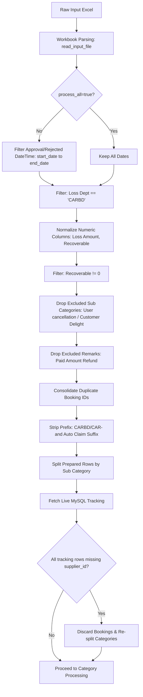

# Data Pipeline & Ingestion Engine

This document provides a complete specification of the data ingestion, validation, pre-filtering, deduplication, and batch-splitting pipeline executed in `backend/app/domain/penalty_dataset.py`, `backend/app/domain/subcategories.py`, and `backend/app/services/pipeline.py`.

---

## 1. Input Workbook Specification

The ingestion engine accepts QlikSense loss-recovery workbooks in `.xlsx` or `.xls` format. The workbook must contain the following required columns (case-sensitive):

```python
REQUIRED_INPUT_COLUMNS = {
    "Booking ID",
    "Booking Date",
    "Booking Month",
    "Loss Dept",
    "Sub Category",
    "Loss Amount",
    "Recoverable",
    "Remarks",
    "Approval/Rejected DateTime",
}
```

If any of these columns are missing, `validate_input_columns` raises a `ValueError` immediately, and the job transitions to `failed`.

---

## 2. Ingestion & Filtering Workflow



---

## 3. Detailed Step-by-Step Logic

### Step 1: Datetime Parsing & Date Range Filtering

QlikSense exports dates in diverse formats, frequently embedding timestamps with arbitrary whitespace (e.g., `20/07/2026  4:29:37 PM`).

- **Parsing Function:** `parse_approval_datetimes(series: pd.Series) -> pd.Series`
  - Strips leading/trailing whitespace and collapses repeated internal spaces.
  - Matches day-first strings matching `^\d{1,2}/\d{1,2}/\d{4}` using explicit formats:
    - `"%d/%m/%Y %I:%M:%S %p"`
    - `"%d/%m/%Y %H:%M:%S"`
    - `"%d/%m/%Y"`
  - Day-first parsing prevents ambiguous month/day swapping (e.g., `05/06/2026` is June 5th, not May 6th).
  - Falls back to standard ISO-8601 parsing for remaining timestamps.
- **Range Filtering:** `filter_by_input_date_range(df, date_column, start_date, end_date)`
  - Both `start_date` and `end_date` are normalized to calendar midnight (`.dt.normalize()`).
  - Inclusive boundary check: `day.ge(start) & day.le(end)`.
  - When `process_all=True` is passed to `POST /api/jobs`, the date range check is bypassed entirely.

### Step 2: Loss Department & Recoverable Filtering

1. **CARBD Filter:**
   - Function: `keep_only_carbd_loss_dept(df, loss_dept_column="Loss Dept")`
   - Only rows where `Loss Dept` (trimmed, upper-cased) equals `"CARBD"` are retained. Other business units (e.g., Outstation, B2B) are excluded.
2. **Numeric Normalization:**
   - Function: `normalize_numeric_columns(df, columns)`
   - Converts `Loss Amount`, `Loss Amount (INR)`, `Recoverable`, and `Recoverable (INR)` to floating-point numbers; invalid or unparseable entries default to `0.0`.
3. **Non-Zero Recoverable Filter:**
   - Function: `remove_zero_recoverable_rows(df, recoverable_column="Recoverable")`
   - Rows where `Recoverable == 0` are dropped, as no vendor penalty can be recovered.

### Step 3: Upfront Business Drop Rules

Certain cases represent non-vendor actions or customer compensation that must not be penalized against vendors:

#### A. User Cancellation & Customer Delight Exclusion
- Function: `drop_excluded_subcategories(df, sub_category_column="Sub Category")`
- Normalization: Strips `^(?i)\s*(?:carbd|car)\s*-\s*` prefixes and punctuation.
- Rule: Rows are dropped if the normalized subcategory equals `"user cancellation"` or contains the phrase `"customer delight"` (case-insensitive).
- Metric: Emits count of dropped rows in pipeline summary.

#### B. Paid-Amount Refund Exclusion
- Function: `drop_excluded_remarks(df, remarks_column="Remarks")`
- Normalization: Strips trailing auto-claim suffixes matching `(?i)\s*-\s*auto\s*claim\s*raised\b`.
- Regular Expression:
  ```python
  PAID_AMOUNT_REFUND_REMARK_PATTERN = re.compile(
      r"\b(?:paid amount refund|refund of(?: the)? paid amount)\b"
  )
  ```
- Rule: Rows matching this pattern represent refund pass-throughs rather than operational vendor penalties and are dropped upfront.

### Step 4: Duplicate Booking Consolidation

Multiple claims can be logged against the same `Booking ID`. They must be consolidated into a single primary record using `consolidate_duplicate_bookings(df)`.

1. **Grouping:** Group rows by `Booking ID`.
2. **Primary Row Selection:**
   - Filter to rows where `Loss Dept == "CARBD"`.
   - If CARBD rows exist, select the row with the maximum `Loss Amount`.
   - If no CARBD rows exist, select the overall row with the maximum `Loss Amount`.
3. **Amount Aggregation:**
   - `Loss Amount` = sum of `Loss Amount` across all rows in the group.
   - `Loss Amount (INR)` = sum of `Loss Amount (INR)` across all rows.
   - `Recoverable` = sum of `Recoverable` for rows where `Loss Dept != "CD"` (Customer Delight).
   - `Recoverable (INR)` = sum of `Recoverable (INR)` for rows where `Loss Dept != "CD"`.
4. **Remarks Merging:**
   - If **all** rows in the group belong to `CARBD`, Remarks are merged:
     - Deduplicated while preserving original appearance order.
     - Joined using `DEFAULT_REMARK_SEPARATOR = " / "`.
   - If the group contains non-CARBD rows, the primary row's remarks are retained.
5. **Traceability Metadata:**
   - `Merged Row Count`: Total count of grouped rows.
   - `Merged Loss Depts`: Distinct loss departments joined by `" / "`.

### Step 5: Text Cleanup & Shaping

- Function: `clean_output_text_columns(df)`
  - `Sub Category`: Strips `SUB_CATEGORY_PREFIX_PATTERN = r"(?i)^\s*(?:carbd|car)\s*-\s*"`.
  - `Remarks`: Strips `AUTO_CLAIM_RAISED_REMARK_PATTERN = r"(?i)\s*-\s*auto\s*claim\s*raised\b"`.
- Function: `shape_loss_recovery_output(df)`
  - Projects DataFrame to the 8 standard prepared columns:
    `["Booking ID", "Booking Date", "Booking Month", "Loss Dept", "Sub Category", "Loss Amount", "Recoverable", "Remarks"]`.

### Step 6: Subcategory Splitting & Slug Generation

- Module: `backend/app/domain/subcategories.py`
- Functions: `split_by_subcategory(df)`, `slugify(value)`
  - Subcategories with missing or blank values normalize to `"Uncategorized"`.
  - Slugs are created by lower-casing and replacing non-alphanumeric characters with hyphens (e.g., `Cab Delay` → `cab-delay`).
  - Collision avoidance: If two categories produce identical slugs, unique numerical suffixes are appended (`slug`, `slug-2`, etc.).
  - Each subcategory batch is exported to `category_files/prepared/{slug}.xlsx`.

### Step 7: Live Tracking & Discarding Missing Supplier IDs

After live tracking data is retrieved from MySQL:

1. **Missing Tracking Match Warning:**
   - Bookings with zero records in `tracking_reports_raw` trigger a `tracking_not_found` warning containing the affected `Booking ID`s.
2. **Missing `supplier_id` Discard Rule:**
   - Function: `booking_ids_missing_supplier_id(tracking_bookings, booking_ids)`
   - Checks every tracking row associated with each booking.
   - If a booking has tracking rows, but **every row has a NULL, empty, or missing `supplier_id`** (or has no tracking records at all), it cannot be penalized against any vendor.
   - **Action:**
     - The affected booking IDs are completely discarded from `prepared_df`.
     - A warning `supplier_id_missing` is emitted containing the discarded booking IDs.
     - Stale category files in `category_files/prepared/` are deleted.
     - The subcategory split is re-computed and re-written from the filtered DataFrame.

---

## 4. Pipeline Execution Metrics

The pipeline calculates and tracks cumulative row metrics returned in `PipelineResult.metrics` and exposed via `GET /api/jobs/{id}`:

| Metric Key | Description |
| :--- | :--- |
| `raw_rows` | Total row count in uploaded workbook. |
| `date_filtered_rows` | Rows matching approval date range (or all rows if `process_all=True`). |
| `process_all` | `1` if date filtering was bypassed, else `0`. |
| `carbd_rows` | Rows with `Loss Dept == "CARBD"`. |
| `recoverable_rows` | Rows with non-zero recoverable amount. |
| `excluded_subcategory_rows` | Count of dropped `User cancellation` / `Customer Delight` rows. |
| `excluded_remarks_rows` | Count of dropped paid-amount refund remarks. |
| `prepared_rows` | Unique consolidated bookings ready for category processing. |
| `category_count` | Number of distinct subcategories identified. |
| `tracking_matched_bookings` | Bookings matched with at least one tracking record. |
| `tracking_unmatched_bookings` | Bookings completely absent from live tracking. |
| `supplier_id_discarded_bookings` | Bookings discarded due to missing `supplier_id`. |
| `final_output_rows` | Rows finalized in `final_output.xlsx` after edit approvals. |

