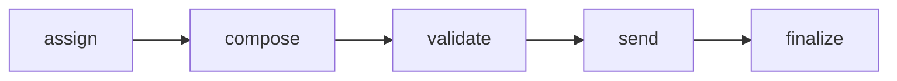
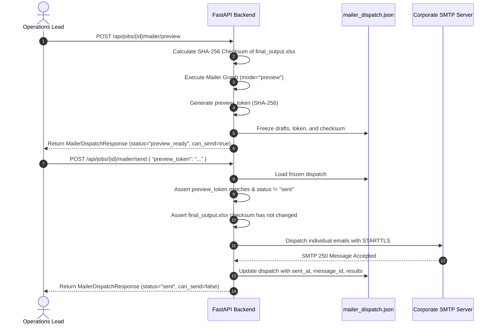

# Vendor Penalty Mailer Engine

This document specifies the deterministic email templating, recipient assignment, preview freeze token protocol, and SMTP dispatch pipeline in `backend/app/services/mailer.py`, `backend/app/agents/mailer/`, and `backend/app/domain/mail_templates.py`.

---

## 1. Overview & Policy Invariants

After a job reaches `succeeded`, operations teams can trigger vendor penalty notifications from the Outputs page (`/jobs/{id}/outputs`).

### Non-Negotiable Invariants
1. **Zero LLM Rewriting:** Mail titles, messages, fines, and transcripts are formatted strictly deterministically. The mailer uses **zero LLM tokens**.
2. **Two-Phase Idempotency:** Mails must be previewed and frozen before dispatch. A cryptographic SHA-256 `preview_token` ensures that emails cannot be dispatched if the underlying workbook changes or if a send is already completed.
3. **Recipient Isolation:** Delivery failures are tracked per recipient. A network failure on one email marks that recipient as `failed` while allowing others to complete (`partial` dispatch).

---

## 2. Mailer LangGraph Topology

The vendor penalty mailer runs as an independent deterministic LangGraph with thread ID `"{job_id}:mailer"`:



- **`assign` Node:** Maps configured recipients (`MAILER_RECIPIENTS`) to booking rows from `final_output.xlsx`.
- **`compose` Node:** Renders deterministic plain text and HTML bodies with bold table keys.
- **`validate` Node:** Asserts all required fields (`recipient`, `booking_id`, `subject`, `text_body`, `html_body`) are present and non-empty.
- **`send` Node:**
  - In `mode="preview"`, this node is skipped (`status = "preview_ready"`).
  - In `mode="send"`, iterates through drafts and dispatches them via `MailTransport`.
- **`finalize` Node:** Records dispatch timestamps and sets final status (`sent`, `partial`, or `failed`).

---

## 3. Recipient Assignment & Booking Selection

Implemented in `backend/app/domain/mail_assignment.py`:

1. **Configured Recipients:** Loaded from `.env` via `MAILER_RECIPIENTS` (comma-separated list of emails).
2. **Deterministic Seeded Selection:**
   ```python
   seed_material = f"{job_id}:{final_output_checksum}:{','.join(recipients)}"
   rng = random.Random(seed_material)
   ```
   A seeded random generator guarantees that repeated preview calls produce the identical recipient-to-booking assignment.
3. **Unique vs. Round-Robin Assignment:**
   - If `len(rows) >= len(recipients)`: Each recipient is assigned a unique booking.
   - If `len(rows) < len(recipients)`: Booking rows are reused in a round-robin sequence (`rows[index % len(rows)]`) so that **every recipient always receives an email**.

---

## 4. Deterministic Email Templates

Defined in `backend/app/domain/mail_templates.py`.

### A. Subject Line
```text
Penalty complaint details - {booking_id}
```

### B. Standardized Email Fields
Every email contains the following key-value pairs:
1. `title`: Value from `final_output.xlsx` (default: `"Service Issue"`).
2. `message`: Canonical complaint string (e.g. `"Vendor No Show"`).
3. `Fine`: Integer or floating-point penalty amount from `final_output.xlsx` (e.g. `"500"`).
4. `call transcript`: Customer call transcript from Redash (if non-empty).
5. `complaint against booking`: Booking ID.

### C. Plain-Text Format
```text
hi ,
here is the details of the complaint below

title : Service Issue
message : Vendor No Show
Fine : 500
call transcript : Customer reported cab never arrived.
complaint against booking : MMT1001

Thanks ,
cabs team
```

### D. HTML Format
Emails are formatted as clean, responsive HTML tables:
- Table border: `1px solid #d0d7de`, collapse borders.
- Cell padding: `6px 12px`.
- Keys are wrapped in `<strong>` tags.
- Typography: Arial, sans-serif, 14px font, `#111` text color.

---

## 5. Two-Phase Preview & Send Protocol



### Dispatch Artifact: `mailer_dispatch.json`
Saved directly within the job runtime folder (`backend/.runtime/{job_id}/mailer_dispatch.json`):

```json
{
  "status": "sent",
  "preview_token": "9f83ac241...",
  "final_output_checksum": "a1b2c3d4...",
  "recipients": ["manager1@go-mmt.com", "manager2@go-mmt.com"],
  "drafts": [
    {
      "recipient": "manager1@go-mmt.com",
      "booking_id": "MMT1001",
      "subject": "Penalty complaint details - MMT1001",
      "title": "Service Issue",
      "message": "Vendor No Show",
      "fine": "500",
      "call_transcript": "Customer reported cab never arrived."
    }
  ],
  "results": [
    {
      "recipient": "manager1@go-mmt.com",
      "booking_id": "MMT1001",
      "status": "sent",
      "message_id": "<20261104.12345@smtpmail.mmt.com>",
      "sent_at": "2026-11-04T00:00:00+00:00"
    }
  ],
  "sent_at": "2026-11-04T00:00:00+00:00",
  "can_send": false
}
```

### Safety & Idempotency Rules
1. **Stale Token Check:** If `final_output.xlsx` is modified after preview, the checksum test fails with `409 Conflict`.
2. **Double Send Guard:** Calling `/mailer/send` when status is already `sent` returns `409 Conflict: Mail has already been sent for this job`.
3. **Locking:** Each job uses a re-entrant lock (`_job_lock(job_id)`) to prevent concurrent race conditions during dispatch.

